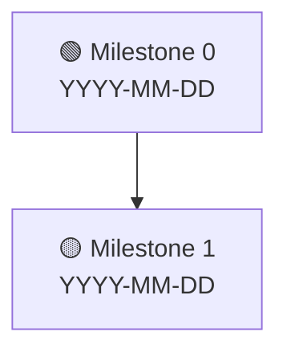

# project.md template

Keep the file flat: every section is a top-level `##`, with no subdirectories or extra files. Keep the section order below so diffs stay readable.

~~~markdown
# Project: <name>

**Linear:** [<project name>](<url>) | **Status:** 🟢 On track / 🟡 At risk / 🔴 Behind | **Updated:** YYYY-MM-DD

## Summary

<One paragraph: what the project is, why it matters, the next ship date or deadline (for example a code freeze).>

## Milestones

| Milestone | Target | Status | Open urgent | Open / total | Linear |
|---|---|---|---|---|---|
| <name> | YYYY-MM-DD | 🟢/🟡/🔴 | 0 | 3 / 12 | [link](<url>) |

## Workstreams

| Workstream | Label | Teams | Owner | Current focus |
|---|---|---|---|---|
| <name> | `workstream:<label>` | <team> | <person> | <focus> |

## Dependency Graph

## Blockers

| Blocker | Affects | Since | Owner | Linear |
|---|---|---|---|---|

## Risks

| Risk | Likelihood | Impact | Mitigation | Owner |
|---|---|---|---|---|

## Decisions

| Date | Decision | Who | Link |
|---|---|---|---|

## Upcoming (next 14 days)

| Date | Item | Milestone |
|---|---|---|

## Remote References

| Document | Purpose | Link | Last pulled |
|---|---|---|---|
| Weekly update | Where `/pm update` publishes, and the previous one to match | <url> | |

## Sources

<Where `/pm update` and `/pm risks` look beyond Linear.>

| Source | Kind | Notes |
|---|---|---|
| #<channel> | Slack | <standups, launches, ...> |
| <meeting name> | Granola | <weekly sync> |
| <org/repo> | GitHub | <release PRs> |

## Draft Tickets

<!-- Tickets drafted but NOT yet in Linear. -->

## Filed Tickets

<!-- - [ABC-123](url): <title> (filed YYYY-MM-DD) -->
~~~

## Ticket draft format

Write the body following the `linear-tickets` skill: bullets and tables over prose. A small ticket carries the full context an agent needs to pick it up. A large one stays high level and says to break out sub-tickets.

~~~markdown
### [DRAFT] <title>
- **Milestone:** <name>
- **Team:** <Linear team>
- **Workstream:** `workstream:<label>`
- **Priority:** Urgent / High / Medium / Low
- **Parent:** <ID or draft title, or —>
- **Blocked by:** <IDs or draft titles, or —>

<What to do, where in the code, which pattern to follow, why it matters for the project.>

**Acceptance criteria**
- ...
~~~
